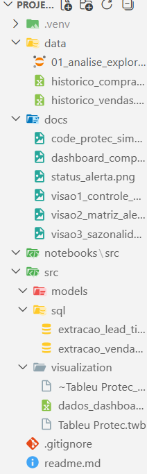
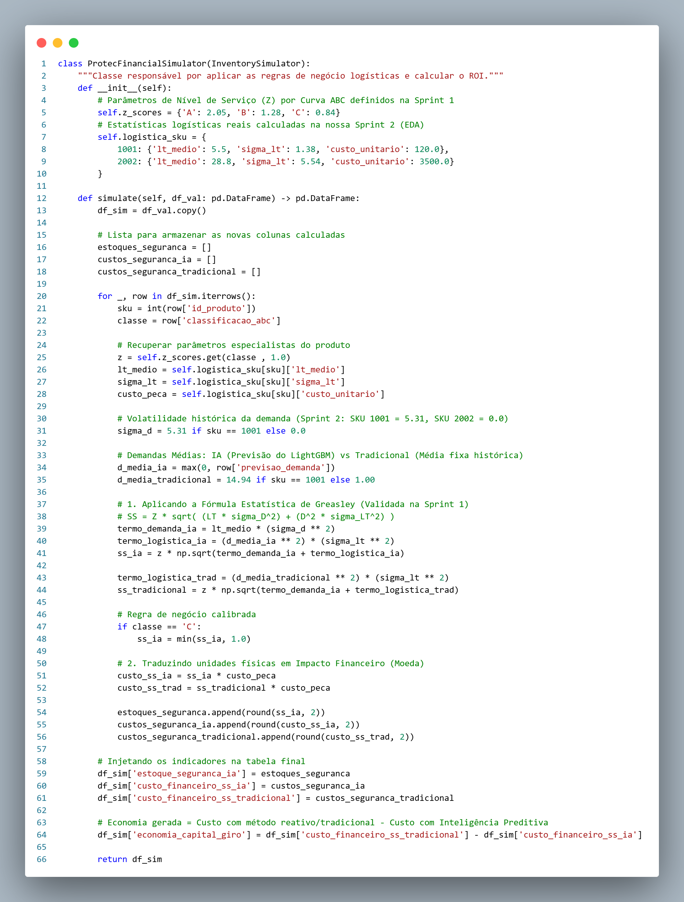
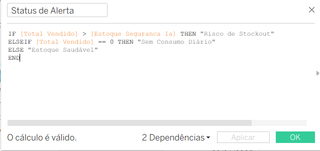
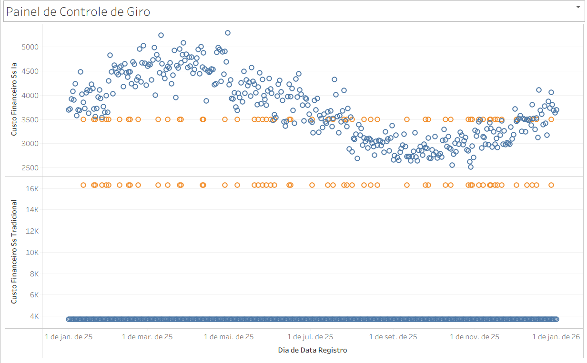
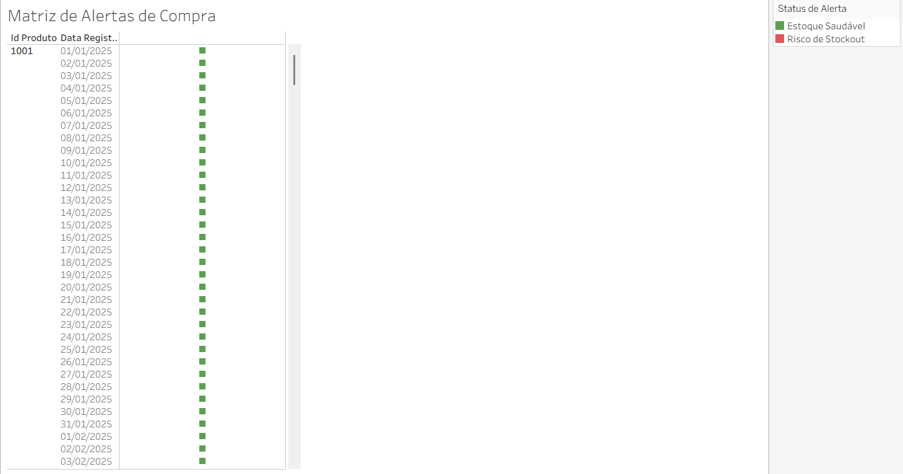
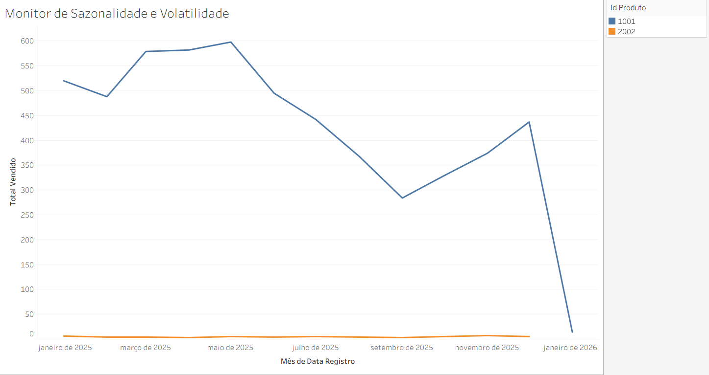

# Otimização de Estoque Preditivo e Capital de Giro | Protec Automação

---

## 1. Visão Geral do Projeto e Contexto de Negócio

### **"Os dados deste projeto são simulados. O MAE global de 2,95 unidades foi medido no horizonte de 2025 dessa base simulada."**

A **Protec Automação** é uma distribuidora industrial B2B que enfrentava o desafio clássico da gestão de inventário em grande escala:
* **Overstock (Excesso de Estoque):** Itens de alto valor unitário e baixa rotatividade (ex: Inversores de Frequência - Classe C) acumulavam custos astronômicos de retenção no galpão.
* **Stockout (Ruptura de Estoque):** Componentes essenciais de alto giro (ex: Sensores Óticos - Classe A) sofriam com desabastecimento em momentos de picos operacionais, gerando atrasos em clientes industriais.

O objetivo principal deste projeto foi construir uma **pipeline end-to-end automatizada** que substituísse as compras reativas por **Inteligência Preditiva (LightGBM)** e simulação de **Estoque de Segurança Estatístico (Fórmula de Greasley)**, conectando os resultados diretamente a um **painel no Tableau**.

---

## 2. Impacto Financeiro Consolidado (ROI)

Ao aplicar o modelo preditivo e calibrar as regras de negócio para componentes de alto valor imobilizado, a solução alcançou resultados financeiros expressivos:

* **Capital de Giro Liberado:** **R$ 696.330,91**
* **Redução do Custo Imobilizado:** Suavização de custos de armazenagem desnecessários em itens Classe C (Itens de alto valor e baixa rotatividade).
* **Nível de Serviço Preservado:** Garantia de cobertura diária contra *stockout* para produtos Classe A (Itens de alto giro).

---

## 3. Arquitetura da Solução e Princípios SOLID

O projeto foi estruturado seguindo rigorosamente as abstrações do padrão **SOLID** para garantir modularidade, desacoplamento e testabilidade:

---

## 4. Metodologia Técnica e Pipeline de Dados

* **A. Simulação Financeira & Calibração de Regra de Negócio (Python)**: Para evitar que a volatilidade dos fornecedores inflasse o custo de peças caríssimas (Classe C), aplicamos a fórmula estatística de Greasley com uma trava de segurança no simulador.

* **Fórmula do Tableau para Alertas de Stockout (Lógica Não Agregada)**: No Tableau, para evitar mascarar ruídos diários com somatórios anuais, reescrevemos a fórmula de alerta para avaliar os registros dia a dia:

---

## 5. Dashboard Executivo (Tableau)

**Detalhamento das Visões Estratégicas**

* **Painel de Controle de Giro**: Demonstra a divergência no tempo ("boca do jacaré") entre o custo fixo e elevado do modelo tradicional (linha azul) e o custo otimizado trazido pelo modelo preditivo de IA (linha laranja).

* **Matriz de Alertas de Compra**: Monitoramento diário linha a linha que auxilia o time de suprimentos a identificar o teto de segurança e destaca em vermelho dias específicos com risco iminente de desabastecimento (stockout).

* **Monitor de Sazonalidade e Volatilidade**: Acompanhamento gráfico das flutuações sazonais de mercado para os itens Classe A e controle dos atrasos logísticos dos fornecedores.

## 6. Como Reproduzir este Projeto

Pré-requisitos
Python 3.10+

Tableau Desktop ou Tableau Public

**Passo a Passo**

# 1. Clonar o repositório
git clone https://github.com/ewevx/<protec-automacao-estoque>.git
cd protec-automacao-estoque

# 2. Criar e ativar o ambiente virtual
python -m venv .venv
source .venv/bin/activate  # No Windows: .venv\Scripts\activate

# 3. Instalar as dependências
pip install pandas numpy lightgbm scikit-learn

# 4. Executar o notebook principal
Abra notebooks/01_analise_exploratoria.ipynb e rode todas as células.

